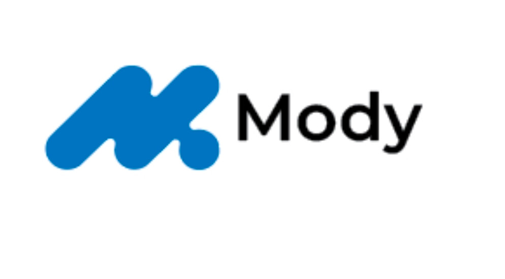
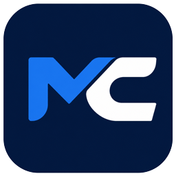

  
  &nbsp;&nbsp;
  

<h1 align="center">ModyCrew · 모디크루</h1>

<strong>일상에서 회사 업무까지, AI 크루와 함께.</strong> Mody 팀이 만드는 AI 업무 앱

모디크루는 여러 AI와 메일·문서·일정·파일 작업을 한곳에서 이어주는 한국어 중심 AI 업무 앱입니다. 대화로 일을 요청하고, AI 크루의 작업과 결과를 확인할 수 있는 환경을 만들어 갑니다.

- **대화로 시작하기** — 일상적인 질문부터 자료 읽기, 문서 초안, 개발 업무까지.
- **내 도구 연결하기** — 사용 중인 AI와 업무 서비스를 연결해 함께 활용합니다.
- **결과 확인하기** — 크루 사무실과 승인함에서 작업 상태와 확인할 내용을 살펴봅니다.

연결한 서비스와 운영체제에 따라 사용할 수 있는 기능이 다릅니다. 외부 발송·일정 등록처럼 중요한 작업은 확인과 승인을 거쳐 진행합니다.

### 시작하기

[모디크루 소개 및 다운로드](https://mody.ai.kr/modycrew#desktop-downloads) · [공개 배포 안내](https://github.com/Ming-gu1021/modycrew-downloads)

### 만든 팀

**Mody 팀**은 복잡한 설정을 줄이고, 누구나 AI를 일상과 업무에서 쉽게 사용할 수 있도록 모디크루를 개발하고 있습니다.

[Mody 공식 홈페이지](https://mody.ai.kr)

---

이 저장소는 제품 소개와 공식 브랜드 자료를 제공합니다. 로고와 제품명에 대한 권리는 Mody에 있습니다.
